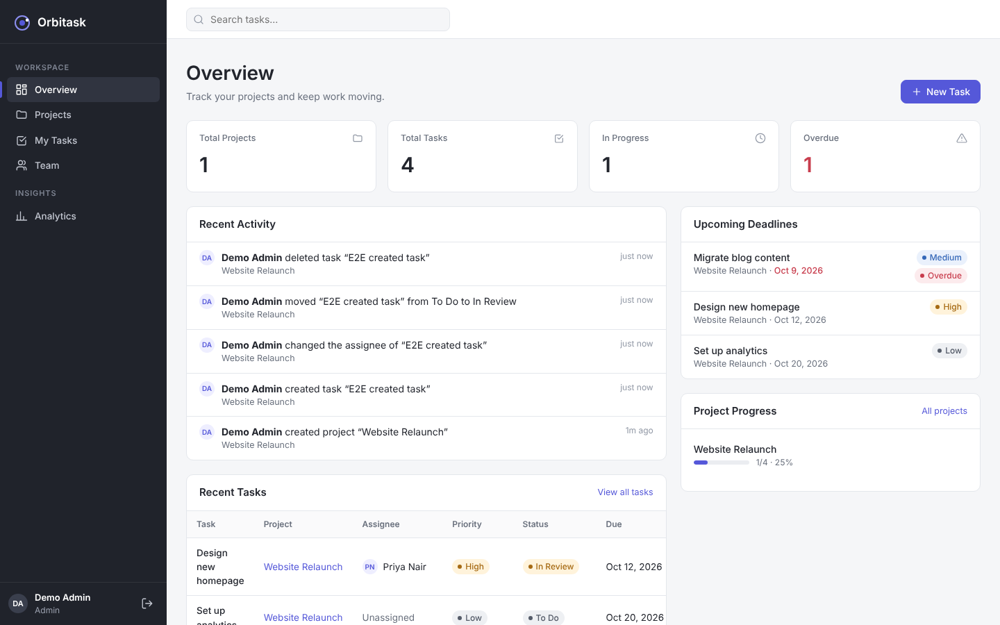
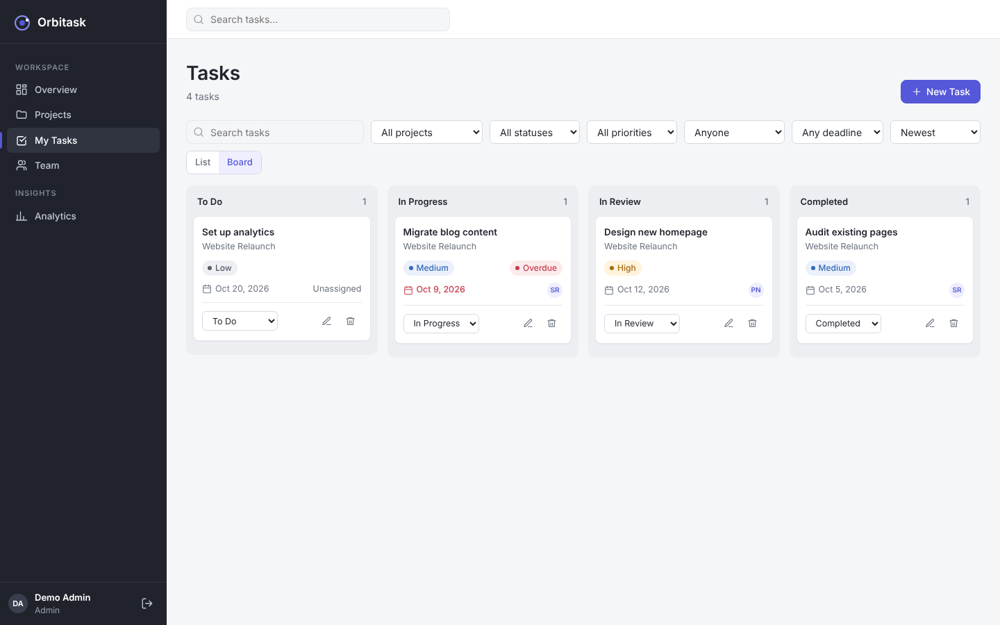

# Orbitask

Orbitask is a project and task management app built for the StartupMeu Software Engineer Intern (MERN) assessment. Teams create projects, assign tasks to project members, track progress on a Kanban board or list, and see real-time-computed dashboard and analytics numbers.

> **Status of this README:** sections marked **TODO (you)** must be filled in with things only you can do or know (GitHub URL, deployment URLs, your genuine Code0 usage). They are intentionally left blank rather than invented.

## Key features

- Email/password auth with bcrypt hashing; JWT stored in an **HttpOnly cookie**; logout invalidates tokens server-side.
- Roles: **Admin** and **Member** (enforced on the server, never only in the UI).
- Projects (CRUD, archive status, member management) and tasks (CRUD, status, priority, dates, assignee).
- Task **List** and **Board** views backed by the same API data, with search, filters (project, status, priority, assignee, deadline), sorting and pagination.
- Dashboard (KPIs, recent activity, upcoming deadlines, project progress, recent tasks), Team directory, Analytics (status/priority distribution, project completion, overdue, workload).
- Server-recorded activity history (project, task, assignment, status, priority and membership events).
- Responsive layout (sidebar → compact rail → drawer), accessible dialogs, loading/empty/error states.

## Technology

| Layer | Tech |
|---|---|
| Frontend | React 19, Vite, React Router, plain CSS (design tokens in `client/src/styles/index.css`), Fetch API, inline SVG icons |
| Backend | Node.js, Express, REST, helmet, cors, express-rate-limit |
| Database | MongoDB Atlas via Mongoose |
| Tests | Node built-in test runner + supertest |

## Project structure

```
client/src/  components/ context/ features/ hooks/ layouts/ pages/ services/ styles/ utils/
server/      config/ models/ routes/ controllers/ middleware/ services/ validators/ utils/ tests/
docs/screenshots/
```

## Prerequisites

Node.js 20+ (developed on Node 22), npm, a MongoDB Atlas account (free M0 cluster).

## MongoDB Atlas setup

1. Create a free account and an **M0** cluster at <https://www.mongodb.com/cloud/atlas>.
2. **Database Access** → add a database user with a strong password (read/write on any database is enough).
3. **Network Access** → add your current IP (for local dev). For a hosted backend, add the host's outbound IPs or `0.0.0.0/0` (acceptable for an assessment; restrict it in real projects).
4. **Connect → Drivers** → copy the connection string, put the database name in it (e.g. `.../orbitask?retryWrites=true&w=majority`).
5. Put it in `server/.env` as `MONGODB_URI` — **never commit this file**.

## Environment variables

`server/.env` (copy from `server/.env.example`):

| Variable | Purpose |
|---|---|
| `PORT` | API port (default 5000) |
| `NODE_ENV` | `development` / `production` |
| `MONGODB_URI` | Atlas connection string |
| `JWT_SECRET` | Random string, ≥ 16 chars (`node -e "console.log(require('crypto').randomBytes(32).toString('hex'))"`) |
| `CLIENT_URL` | Allowed browser origin(s) for CORS, comma-separated |
| `FIRST_USER_ADMIN` | `true` → the **first** account ever registered becomes Admin |
| `DNS_SERVERS` | Optional DNS override for `mongodb+srv://` lookups |
| `SMTP_HOST`, `SMTP_PORT`, `SMTP_SECURE`, `SMTP_USER`, `SMTP_PASS`, `SMTP_FROM` | Outgoing email. `SMTP_FROM` is the only From address ever used. If `SMTP_HOST`/`SMTP_FROM` are empty, email features report "not configured" instead of pretending to send |

`client/.env` (only for production builds): `VITE_API_URL=https://your-api-host`. In development leave it empty; Vite proxies `/api` to `localhost:5000`.

## Install and run

```bash
npm run install:all          # installs server and client dependencies
cp server/.env.example server/.env   # then fill in MONGODB_URI and JWT_SECRET
npm run dev:server           # API on http://localhost:5000
npm run dev:client           # UI on http://localhost:5173  (second terminal)
```

Optional demo data (development only, refuses to run in production, **wipes the database it points at**):
`npm run seed` → logins `admin@orbitask.dev` / `Password123` (and `sam@…`, `priya@…`).

Admin setup: with `FIRST_USER_ADMIN=true`, register the first account — it becomes Admin. Everyone after that is a Member. There is no way to choose a role at registration.

## Testing

```bash
npm test
```

Runs 75 API tests across 7 files (auth, authorization, project/task CRUD, dashboard, notifications, invitations & join requests, roles & audit, password/account security, workspace email). `cd client && npm test` runs the UI tests (the show/hide eye exists on Sign In only). Tests start an in-memory MongoDB via `mongodb-memory-server` (downloads a MongoDB binary on first run), or use your own server by setting `TEST_MONGODB_URI=mongodb://127.0.0.1:27017`. They use a throwaway database and drop it afterwards.

Production build: `npm run build` (outputs `client/dist`).

## Authentication and authorization model

- JWT (7 days) in an `HttpOnly` cookie (`Secure` + `SameSite=None` in production because the UI and API are on different origins; `Lax` locally).
- CSRF: all mutating requests must carry `X-Requested-With: orbitask`; CORS only allows `CLIENT_URL`. A cross-site form cannot set that header.
- Trade-off: cookies are immune to token theft via XSS but need the CSRF/CORS care above; localStorage tokens would be simpler but readable by any injected script.
- Logout increments the user's `tokenVersion`, invalidating every previously issued token.
- Auth endpoints are rate-limited. Request bodies are capped at 50 KB. Responses never include password hashes.

| Action | Admin (project owner) | Member of project | Non-member |
|---|---|---|---|
| Create project | ✅ (Admin role required) | ❌ 403 | ❌ 403 |
| View project / its tasks / activity | ✅ | ✅ | 404 |
| Edit / delete project, add/remove members | ✅ owner only | ❌ 403 | 404 |
| Create task | ✅ | ✅ | 404 |
| Assign task to others | ✅ owner only | ❌ (may assign **self**) | 404 |
| Edit task | ✅ owner | creator or assignee | 404 |
| Delete task | ✅ owner | creator only | 404 |

Non-members get **404** (not 403) so project existence isn't leaked. Assignees must be project members. Dashboard, analytics, team and activity are scoped to projects the user can access. Workload analytics is Admin-only. Overdue = due date before today (UTC) and not completed. Project progress is always computed from tasks (0% when there are none).

## API

All routes are under `/api`; errors look like `{ "error": { "message", "details?" } }`.

| Method | Route | Notes |
|---|---|---|
| GET | `/health` | 200 when DB connected, 503 otherwise |
| POST | `/auth/register`, `/auth/login`, `/auth/logout` | logout requires auth |
| GET | `/auth/me` | current user |
| GET | `/users`, `/users/:id` | scoped to people you share projects with (Admin: all) |
| PATCH | `/users/me` | name only |
| GET/POST | `/projects` | list supports `q, status, sort, order`; POST Admin only |
| GET/PATCH/DELETE | `/projects/:id` | PATCH/DELETE owner only |
| POST | `/projects/:id/members` | body `{ userId }` — creates an **invitation** (no direct add) |
| POST | `/projects/:id/transfer` | owner only; new owner must be an Admin and a member |
| POST | `/auth/forgot-password`, `/auth/reset-password`, `/auth/change-password` | generic response / single-use hashed token / re-auth |
| GET | `/account/deletion-check` · DELETE `/account` | blockers · needs password + `confirm: "DELETE"` |
| GET | `/notifications` (`limit, unread, before`), `/notifications/unread-count` | own only |
| POST/PATCH | `/notifications/read-all`, `/notifications/:id/read` | |
| GET | `/invitations`, `/invitations/discover` | received / my requests / to review / sent |
| POST | `/invitations` (owner Admin), `/invitations/request` | invite a user · ask to join |
| PATCH | `/invitations/:id` | `{ action: accept\|decline\|cancel\|approve\|reject }`, atomic and exactly-once |
| GET/PATCH | `/users/search`, `/users/:id/role`, `/admin/audit` | Admin only |
| GET/PATCH | `/workspace/settings` | PATCH Admin only (`allowMemberToMemberEmail`) |
| GET/POST | `/email/recipients`, `/email/history`, `/email/send` | names only, own history, rate limited |
| DELETE | `/projects/:id/members/:userId` | unassigns their tasks |
| GET/POST | `/tasks` | list supports `q, projectId, status, priority, assignedTo (id\|me\|unassigned), due (overdue\|week\|none), sort (createdAt\|dueDate\|priority), order, page, limit` |
| GET/PATCH/DELETE | `/tasks/:id` | |
| GET | `/dashboard/stats`, `/dashboard/deadlines` | |
| GET | `/analytics` | extra endpoint powering the Analytics page |
| GET | `/activity` | `projectId`, `limit` |

## Screenshots

Captured from the running app with demo seed data: `docs/screenshots/` — `login`, `dashboard`, `projects`, `tasks-list`, `tasks-board`, `analytics`, `mobile-board`.




## Feature guide

- **Sign in**: eye button shows/hides the password (Sign In only) and a *Forgot password?* link.
- **Notifications**: bell with unread count, dropdown, `/notifications` page (filter, load more, mark read). Stored in MongoDB; links come from the server.
- **Invitations & requests** (`/requests`): Admin project owners invite people; members can ask to join. Accept/decline/cancel/approve/reject; membership is added exactly once and duplicate pending items are blocked by a unique index.
- **Roles** (Team page, Admin): change with confirmation; audit trail; the last Admin cannot be demoted; applies on the very next request.
- **Account security**: change password (signs out other devices); reset by emailed single-use link (token stored hashed, expires); delete account needs password + typing DELETE, is blocked by open assigned tasks, owned projects or being the last Admin, and anonymises the account while keeping team history.
- **Messages**: email people you are allowed to reach (Admins: anyone; members: Admins and owners of their projects, plus project peers if an Admin enables it). One message per recipient, From is always `SMTP_FROM`, your address is only Reply-To. Status is "accepted by mail server", never "delivered".

## Security notes

Passwords hashed with bcrypt (cost 12); secrets only in server env vars; `.env` is git-ignored; helmet headers; strict CORS; input validated on the server for every route (ObjectIds, enums, dates, relationships); regex search input is escaped.

## Known limitations

- No drag-and-drop on the board (status is changed with a persisted dropdown).
- Project progress/metrics are computed in application code over the user's accessible tasks — fine at assessment scale, would move to aggregation pipelines for large datasets.
- No email verification on sign-up. Password reset and Messages need real SMTP credentials; tests use a mock transport, so real delivery has not been verified by the author.
- "Team" in this app means a project's members; roles are global (Admin/Member).
- Notifications use authenticated polling (30 s and on focus), not WebSockets.
- Edit/delete buttons in the UI are shown optimistically for Admins/creators/assignees; the API is the source of truth and returns 403 with a message when not allowed.
- Pagination: list view is paginated (15/page); the board loads up to 100 tasks.

## Code0 confirmation and AI Development Experience

I used Code0 during the development of Orbitask, a MERN-stack project and task management application. I used it to assist with feature implementation, debugging, test development, and code review. I reviewed the generated suggestions, made adjustments where needed, and validated the application through automated tests and manual checks.

### Tasks where Code0 helped

1. **Feature implementation:** Used Code0 to assist with implementing application features and integrating the React frontend with the Express REST API. I reviewed the resulting code and checked the relevant user flows.
2. **Debugging:** Used Code0 to investigate errors and identify possible causes. I checked the proposed fixes against the actual application behavior rather than accepting suggestions without verification.
3. **Automated testing:** Used Code0 to help develop and troubleshoot tests for authentication, account management, projects, tasks, permissions, and other API behavior. I ran the backend test suite to validate the results.
4. **Code review:** Used Code0 to review implementation details, validation, and authorization behavior. I checked the suggestions against the existing code and application requirements.
5. **Build and final verification:** Used Code0 to help investigate development and testing issues. I independently ran the backend test suite, which passed all 75 tests, and the Vite production build, which completed successfully.

### What I learned

AI assistance is useful for exploring unfamiliar code, debugging, and accelerating repetitive work, but its suggestions still require verification. I learned to inspect the implementation, test important edge cases, and rely on actual test results and application behavior instead of assuming that generated code is correct.

## Links

- GitHub repository:https://github.com/shubham-coder-ship-it/orbitask-mern-assessment
- Live frontend: Deployed.
- Live backend: Deployed.

## 👨‍💻 Author
Shubham Sharma
•GitHub: https://github.com/shubham-coder-ship-it 
•LinkedIn: https://www.linkedin.com/in/shubham-sharma-55ab97367

⭐ If you found this project useful, don't forget to star the repository!
